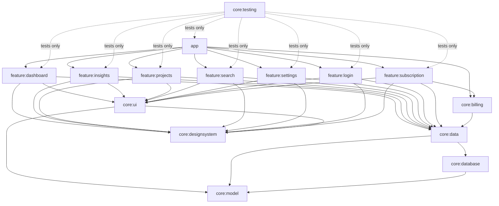

# PortProof architecture

## Principles

1. **Offline-first, local-only.** Room is the single source of truth. There is no backend and no
   account, and PortProof's own code makes no network calls. The only network traffic comes from
   the Google Play Billing library (PortProof Pro), which declares the `INTERNET` permission itself
   (ADR-011). PortProof never sends project data anywhere; only Android's own device backup can
   copy it (see "Security and privacy").
2. **Unidirectional data flow.** Repositories expose `Flow`s; ViewModels combine them into
   immutable UI state; composables render state and send events back as callbacks.
3. **Validated at the boundary.** Every user-entered value passes a validator in `core:model`
   before it can reach a repository (enforced by the type system, see below).
4. **Nothing pretends to work.** Navigation entries, buttons and menus exist only for features
   that are implemented.
5. **No silent data loss.** No destructive migrations, unsaved-change guards, confirmations for
   deletes, archive as the reversible alternative.

## Module structure

| Module | Responsibility | Depends on |
| --- | --- | --- |
| `core:model` | Domain types, stable persistence codes, validation, text sanitising, plan and app-lock rules. Pure Kotlin/JVM. | — |
| `core:database` | Room database, entities, DAOs, `LIKE` escaping, exported schemas | model |
| `core:data` | Repository interfaces and offline-first implementations, DataStore, PIN hashing, app-lock session, `Clock` | database, model |
| `core:billing` | Google Play Billing: subscription catalogue, purchases, cached plan; implements `PlanRepository` | data, model |
| `core:designsystem` | Theme tokens, Inter font, icon set, generic components (no domain types) | Compose |
| `core:ui` | Shared domain-aware UI: project card, status labels, activity row, formatting | designsystem, model |
| `core:testing` | Fakes for every repository (including plan, app lock and subscriptions), `MainDispatcherRule`, screenshot helper | data, billing |
| `feature:*` | One screen family each: route, ViewModel, composables, navigation contract | core modules only |
| `app` | `Application`, `MainActivity` (login gate), app shell (bottom bar, snackbar host) and navigation graph | everything |

Feature modules: `dashboard` (Home), `projects` (list, detail, editor), `search`, `insights`
(Overview, activity log), `settings`, `login` (welcome and first-run setup, unlock screen, Login &
security) and `subscription` (PortProof Pro page). In production code only `subscription` and `app`
see `core:billing`; every other module reads the plan through the `PlanRepository` interface in
`core:data`.

Rules: features never depend on each other (they navigate through callbacks wired in `app`);
only `core:data` sees `core:database`. Shared Gradle configuration lives in convention plugins
(`build-logic/convention`): `portproof.android.application`, `.library`, `.feature`, `.room`,
`.hilt`, `.jvm.library` and the two Compose plugins. A new feature module needs a three-line
build file.

## Layers and data flow

**Reads.** DAO queries return `Flow`s that re-emit on table changes. Repositories map entities to
domain models; ViewModels `combine` flows and expose `StateFlow<UiState>` via
`stateIn(viewModelScope, WhileSubscribed(5_000), initial)`; screens collect with
`collectAsStateWithLifecycle()`, so nothing is collected while the app is in the background.

**Writes.** Every mutation runs in one Room transaction together with its activity-log entry
(`OfflineFirstProjectRepository`). Mutations return `false` when the record no longer exists (for
example, deleted on another screen). Storage exceptions propagate to the ViewModel, which turns
them into a user message; the form keeps its contents so nothing typed is lost.

**Plan limit.** On the free plan at most `PlanRules.FREE_ACTIVE_PROJECT_LIMIT` (3) projects can be
active (not completed, not archived). The check runs inside the same transaction as each write that
would add an active project (create, reopen a completed project, restore from the archive), so
quick repeated taps cannot exceed it. The repository throws `ActiveProjectLimitException`; the
editor shows a notice and the detail screen a snackbar, both with a way to the Pro page. Existing
projects are never locked, hidden or deleted when the limit is reached.

**Entities hold raw persisted values** (status codes, epoch days, epoch milliseconds). Conversion
happens in `core:data/mapper`, with safe fallbacks: an unknown status code becomes `PLANNED`, an
activity row with an unknown code is skipped, an out-of-range date becomes "not set". A corrupted
or newer-format row therefore degrades one field instead of crashing a whole screen.

**Time.** A `java.time.Clock` is injected wherever "now" matters, so tests control time. Day
bucketing (activity chart, "this month" counts) happens in Kotlin with the device time zone rather
than in SQL.

### ViewModel state

- Screen state that comes from the database is a `StateFlow`.
- Text-field state lives in Compose snapshot state inside the ViewModel (`mutableStateOf`), so the
  field updates synchronously while typing (avoids cursor jumps with asynchronous state). A
  `MutableStateFlow` mirror drives debounced search pipelines.
- Anything the user typed or selected is mirrored into `SavedStateHandle` (primitive keys only) and
  restored after process death. The project editor restores its form instead of reloading the
  stored record when it is recreated. PIN digits are the exception: they are never saved, so after
  process death the login setup resumes at *Choose a 6-digit PIN* with the name kept.
- One-off outcomes (saved, deleted, message to show) are modelled as state that the screen
  consumes and then acknowledges (`onSaveHandled()`, `onMessageShown()`), following the Android
  architecture guidance on UI events.

## Validation and input safety

- `ProjectValidator` turns raw `ProjectInput` into a `ProjectDraft`. `ProjectDraft`'s constructor
  is `internal` to `core:model`, so repositories can only receive validated data.
- `TextSanitizer` trims, collapses whitespace in single-line fields, normalises line endings, and
  removes control characters, bidirectional overrides and byte-order marks (these can disguise
  text in exported reports).
- Lengths are measured in Unicode code points. Too-long input is reported as a field error; it is
  never truncated silently.
- Date order is validated (completion date cannot precede the start date).
- Search input is escaped before it is used in `LIKE` patterns (`SqlLike`), so `%` and `_` match
  literally. All SQL uses bound parameters.

## Navigation

Navigation Compose 2.10 with `@Serializable` type-safe routes. Each feature module publishes its
routes plus `NavGraphBuilder` extensions; `app/navigation/PortProofNavHost.kt` wires them together.

**Login gate.** The login screens are not navigation destinations. `MainActivity` (a
`FragmentActivity`, because the system biometric prompt needs a fragment host) asks
`MainActivityViewModel` for a `LoginGate`:

| Gate | Shown |
| --- | --- |
| `Setup` (no PIN stored) | `LoginSetupRoute` replaces the app: welcome pages, profile, create and confirm PIN, optional fingerprint |
| `Locked` | `UnlockRoute` in a full-screen `Surface` above the app. After the first unlock the app stays composed underneath (so the user's place is kept) with its semantics cleared and focus removed, and the `Surface` consumes every touch. Back moves the task to the background |
| `Unlocked` | The app shell |

**Bottom bar.** `TopLevelDestination` defines five slots in the reference's order: Home, Projects,
Search (the orange square in the centre, a scan button in the reference; it becomes the QR scanner
entry in Phase 2), Overview and Settings. Each slot keeps its own back stack (saved and restored on
every switch). The bar is shown only while a top-level destination is on screen.

| Route | Opened from | Notes |
| --- | --- | --- |
| `HomeRoute` | Start destination, bar | Dashboard |
| `ProjectsRoute(filter?, sort?)` | Bar, Home calendar button (Active, by start date), Overview stat cards | Optional preselected filter and sort order |
| `SearchRoute` | Bar (centre) | Global project search, archived projects included |
| `OverviewRoute` | Bar | Project counts, deadlines, recent activity |
| `SettingsRoute` | Bar | Plan, Login & security, profile, theme, privacy |
| `ActivityLogRoute` | Home bell button, Overview *See all* | Every recorded change, grouped by day |
| `SecurityRoute` | Settings *Login & security* | Change PIN, fingerprint unlock, *Lock now* |
| `ProRoute` | Settings plan card, limit notices (*See Pro*) | PortProof Pro page |
| `ProjectDetailRoute(projectId)` | Project cards, search results, deadlines | Contextual project navigation starts here |
| `ProjectEditorRoute(projectId?)` | Home *+* bar, *New project* link, card pencil, *Edit project* | `null` = create. After creating, the editor is replaced by the detail screen |

Equipment and Reports (Phases 2 and 4) will be reached from Home and as project sections. Project
sections (equipment, cabling, tests, defects, photos, report) are reached from the project detail
screen, and QR scans will deep-link to equipment and cable records.

Behaviour:

- Back from a tab returns to Home; Back from Home leaves the app.
- Pushed screens have a back button; project detail also has an *X* that closes to Home
  (`PortProofAppState.navigateHome()`, which pops to `HomeRoute`).
- Back buttons go through `PortProofAppState.navigateBack()`, which ignores a second tap during a
  transition so one tap never pops two screens.
- The editor intercepts Back (system gesture, button and close icon) while there are unsaved
  changes and asks before discarding. Predictive back is enabled
  (`android:enableOnBackInvokedCallback`).
- Deleting a project returns to the previous screen and shows a confirmation snackbar from the
  app shell, so the message survives leaving the deleted project's screen.

## Design system

The interface follows the fourth supplied reference design (a calorie tracker: a dashboard with a
segmented gauge and meal cards, a welcome screen with a pinned food photo, a recipe list with
category tiles and a dark bottom bar). Its food content is replaced by PortProof data:

| Reference element | PortProof implementation |
| --- | --- |
| Square calendar and bell buttons around a centred title | `PpTopBar` with `PpIconButton`s: the calendar opens active projects by start date, the bell opens the activity log |
| Horseshoe gauge "1250 kcal / Goal 2000 kcal" | `PpSegmentedGauge` (11 segments): completed projects out of all non-archived projects, with today's date |
| Wide *+* bar | `PpAddBar`: new project |
| Meal cards ("693 kcal", "35% of goal", protein/carbs/fat, pencil) | `ProjectCard` (`core:ui`): status icon, name, customer and site, last update; a schedule figure (share of the schedule elapsed with "Day X of Y", days until start, days overdue, or 100% when completed); start, due and status columns; the pencil opens the editor |
| Welcome photo with pinned "170 kcal" labels, two-line headline, *Get Started* | `WelcomeScreen` (`feature:login`): drawn illustrations (network cabinet, schedule, phone with PIN) with `PpPinnedLabel`s showing fields PortProof records, page dots, `PpPrimaryButton` |
| Recipe search, category tiles, "Trending Recipes 8" with a badge | Projects tab: `PpSearchField` with a sort button, `PpCategoryTile`s (All, Active, Completed, Archived), `PpSectionHeader` with `PpCountBadge` and a *New project* `PpTextLink` |
| Dark bottom bar with an orange square scan button | `PpBottomBar` with `PpBarItem`s and `PpBarCenterItem` (Search until QR scanning arrives) |

Screens the reference does not show use the same parts: the unlock and setup screens (`PpPinDots`,
`PpKeypad`), the Pro page (`PpChoiceCard` plans with a `PpCountBadge` for the saving), and project
detail and editor (`PpGradientScreen` with the peach header). Project detail keeps the
highlighted project record of the previous design (`PpReviewCard`, `PpSegmentedProgress`,
`PpDocumentCard`, `PpHighlight`) in the new palette.

Highlight rules (`feature/projects/detail/ProjectReview.kt`): yellow for a missing customer, site
or dates and for archived projects; red when the completion date has passed; orange when it is
within 7 days or the project is on hold. They are fixed checks on the stored fields, described in
the UI as such; PortProof makes no AI claims.

Deliberate differences: the reference's AI food recognition, calorie values and photos have no
PortProof equivalent, so the welcome pages use vector drawings and no screen mentions AI. The
centre bar button opens Search until the QR scanner exists (Phase 2). The reference's status bar
and device frame are not part of the app.

Tokens (`core/designsystem/theme`): `PortProofColors` (canvas `#F3F1ED` drawn as a gradient
`#F7F5F2`→`#EFECE7`, white cards with a peach glow `#FFF4EC` at the foot, orange accent `#F4935C`
used only as a fill (gauge, centre bar button, badges, the completed stat card), orange text
`#A4501B`, near-black `#29292B` primary buttons and bottom bar, peach header gradient
`#FBE4D3`→canvas, red/orange/yellow highlight pairs), `PortProofTypography` (Inter, 30sp bold
headline, tabular figures for metrics), `PortProofSpacing` and `PortProofShapes` (18dp tiles,
20dp cards, 14dp controls, 28dp top corners on the bar, pills). The dark theme keeps the structure
on warm graphite (`#131211` canvas, `#1F1E1C` cards) with the same orange and light primary
buttons. The Material 3 scheme is derived from the same tokens; dynamic colour is off.

Contrast (WCAG 2.x, computed from the tokens): every text pair is at least 4.5:1. Lowest in the
light theme: muted text 4.70:1 and orange text 4.76:1 on the darkest canvas point (`#EFECE7`);
secondary text 5.15:1; dark text on orange 7.28:1; white on the near-black bar and buttons
14.52:1, unselected bar labels 7.03:1; highlight text 7.25–8.18:1. Lowest in the dark theme:
6.02:1 (red text on cards). The orange gauge segments measure only 1.78:1 against the unfilled
track in the light theme, below the 3:1 guideline for graphics, so the gauge never carries
information alone: its value is printed in the centre and read out by TalkBack ("13 of 20
projects completed").

Components: `PpCanvas`, `PpListScreen`, `PpGradientScreen`, `PpTopBar`, `PpBottomBar`,
`PpBarItem`, `PpBarCenterItem`, `PpSegmentedGauge`, `PpAddBar`, `PpPrimaryButton`,
`PpSecondaryButton`, `PpIconButton` (Surface, Muted, Dark, Accent), `PpTextLink`, `PpCard`,
`PpPanel`, `PpIconTile`, `PpStatCard`, `PpCategoryTile`, `PpCountBadge`, `PpSectionHeader`,
`PpPinnedLabel`, `PpPinDots`, `PpKeypad`, `PpKeypadIconKey`, `PpChoiceCard`, `PpReviewCard`,
`PpSegmentedProgress`, `PpDocumentCard`, `PpHighlight`, `PpTextField`, `PpPickerField`,
`PpSearchField`, `PpSegmentedControl`, `PpListRow`, `PpLabeledValue`, `PpDivider`,
`PpEmptyState`, `PpConfirmDialog`. Icons: a curated Lucide set generated into `PortProofIcons`
(`tools/icons`, 67 icons). No bitmap artwork is bundled.

### Adaptive layout and accessibility

- Phones: single column. Wider windows centre the content: Home at most 600dp wide, other screens
  at most 880dp, the PIN pad at most 360dp. Headers and the canvas still fill the window.
- Touch targets are at least 48dp, including the PIN keys and bar items.
- Screen titles and section titles are marked as headings; the gauge and the PIN dots have a
  spoken description ("13 of 20 projects completed", "2 of 6 digits entered"); bar items are
  announced as selected tabs; status and highlights are never shown by colour alone (each
  highlight is a sentence); text fields announce validation errors.
- While the app is locked, everything behind the unlock screen is hidden from TalkBack.
- All strings are resources, with plurals where counts appear.

## Error handling

| Situation | Behaviour |
| --- | --- |
| Invalid input | Inline field errors plus a snackbar; nothing is written |
| Write fails (disk full, I/O error) | Snackbar "Couldn't save your changes"; the form keeps its contents |
| Record deleted while open | Detail and editor screens show "Project not found" |
| Unknown or corrupted persisted value | Safe fallback per field (see "Layers and data flow") |
| Preferences file unreadable or corrupted | Defaults are used; a corrupted file is replaced |
| Corrupted database file | **Open issue:** the framework's default handler deletes it. A handler that preserves the file and offers a restore from backup is planned with Phase 4 |
| Wrong PIN | "Wrong PIN" with the attempts left. The 5th wrong PIN in a row starts a 30-second wait; each further wrong PIN doubles it, up to 16 minutes. The keypad is disabled during the wait, which survives restarts. A correct PIN or fingerprint resets the counter |
| PIN can't be checked or saved (storage error) | "Couldn't check your PIN" / "Couldn't save your login"; the app stays locked or in setup |
| Fingerprint cancelled or not recognised | The PIN pad stays available; the system prompt handles its own retries and lockout |
| Forgotten PIN | *Forgot PIN?* explains that there is no recovery and offers *Erase all data* (`ActivityManager.clearApplicationUserData()`), after confirmation |
| Free-plan limit reached | Editor notice or detail snackbar with *See Pro*; nothing is written |
| Google Play unavailable (not installed from Play, signed out, offline, no plans set up) | The Pro page names the reason and offers *Try again*; the last known plan keeps applying |
| Purchase pending (for example, cash payment) | The Pro page says so; Pro starts when Google Play confirms the payment |
| App-lock file corrupted | Replaced with an empty file, so the next start asks for a new PIN; project data is kept (see ADR-012) |

## Security and privacy

- **Permissions:** PortProof declares none itself. Libraries merge in `com.android.vending.BILLING`,
  `INTERNET` and `ACCESS_NETWORK_STATE` (Google Play Billing and Google's logging transport) and
  `USE_BIOMETRIC` and `USE_FINGERPRINT` (androidx.biometric); see ADR-011. androidx.core also adds
  `<applicationId>.DYNAMIC_RECEIVER_NOT_EXPORTED_PERMISSION`, a signature permission only PortProof
  itself can hold. None of them is a runtime permission, so the user is never asked. `CAMERA` arrives in Phase 2 and is requested
  only when the user opens the scanner or camera. Photo import will use the system photo picker,
  which needs no storage permission.
- **App lock:** a 6-digit PIN, stored only as a salted PBKDF2-HMAC-SHA256 hash, with optional
  biometric unlock (Android's `BIOMETRIC_STRONG` class: fingerprint, or face unlock where the
  device rates it as strong). The app locks on every start and after
  5 minutes in the background; wrong PINs are throttled. On Android 13+ the Recents thumbnail is
  disabled so project details don't show in the app switcher. Details and limits in ADR-012.
- **Storage:** the database and preferences live in app-private storage. Photos, reports and
  exports (later phases) will use app-private `files/`, shared only through `FileProvider` URIs
  or files the user explicitly saves through the Storage Access Framework.
- **Backups:** `data_extraction_rules.xml` (Android 12+) and `backup_rules.xml` (Android 8–11)
  include the database and preferences in cloud backup only when it is end-to-end encrypted, and
  everything in device-to-device transfer, except two DataStore files that are excluded from
  both: `app_lock` (PIN hash and attempt counter, so a restored or new device asks for a new PIN)
  and `billing` (the cached subscription check, so a restored device asks Google Play again).
  Photos will be excluded from cloud backup because of size; the in-app backup (Phase 4) covers
  them.
- **Purchases:** handled entirely by Google Play; PortProof never sees payment details. There is
  no server-side verification of purchase tokens (ADR-013).
- **Logging:** customer data, addresses and serial numbers must never be logged. PortProof's own
  code contains no logging; release builds strip `Log.v/d/i` with R8 as a safety net. The billing
  library's own diagnostic logging to Google is described in ADR-011.
- **QR codes** (Phase 2) will carry only an opaque record identifier, never customer data.
- **Release hardening:** R8 minification and resource shrinking are enabled for release builds.
  Release signing keys are kept out of the repository.

## Toolchain and compatibility

Versions were checked on 2026-11-01 against Google Maven, Maven Central and the published
compatibility tables, then verified by building and testing in this repository.

| Component | Version | Why this version |
| --- | --- | --- |
| Android Gradle Plugin | 9.3.3 | Supports compile SDK 37; newest AGP line inside Kotlin 2.4.21's documented compatibility range (AGP ≤ 9.3.1, patch releases included). AGP 9.4/9.5 exist and are evaluated in Phase 5 |
| Gradle | 9.7.1 (wrapper with SHA-256) | AGP 9.3 needs ≥ 9.5.0; KGP 2.4.21 is fully supported up to 9.7 |
| Kotlin (KGP, Compose compiler, serialization plugin) | 2.4.21 | Uses AGP 9 built-in Kotlin; declared at the root to replace AGP's default KGP 2.2.10 |
| KSP | 2.3.13 | Includes the fix for Kotlin 2.4 module names (google/ksp#2964) |
| Hilt | 2.60.1 | Hilt 2.59+ is required for AGP 9; 2.60 reads Kotlin 2.4 metadata (google/dagger#5177) |
| Room | 2.8.5 | `withTransaction` now ships in `room-runtime` |
| Compose BOM | 2026.09.00 (UI 1.12.1, Material 3 1.4.0) | Requires compile SDK 37 and AGP ≥ 9.1 |
| Navigation Compose | 2.10.2 | Type-safe routes, multiple back stacks |
| Lifecycle / Activity / Core | 2.11.0 / 1.13.0 / 1.19.1 | Core 1.19 requires compile SDK 37 |
| AndroidX Hilt (`hiltViewModel`) | 1.4.0 | `androidx.hilt.lifecycle.viewmodel.compose` |
| DataStore Preferences | 1.3.0 | |
| Google Play Billing (`billing-ktx`) | 9.1.0 | Latest release (June 2026). New apps and updates must use version 8 or newer since 31 August 2026 ([deprecation FAQ](https://developer.android.com/google/play/billing/deprecation-faq)); 9 adds sub-response codes and drops deprecated APIs |
| androidx.biometric | 1.1.0 | Latest stable (1.4 is still alpha); `BiometricPrompt` with `BIOMETRIC_STRONG` back to API 26 |
| androidx.fragment | 1.9.1 | `BiometricPrompt` needs a `FragmentActivity`; pins a current fragment version instead of biometric's old transitive one |
| Coroutines / Serialization | 1.11.0 / 1.12.0 | Serialization 1.12 is built on Kotlin 2.4.10 |
| Robolectric | 4.17 | Supports SDK 37; tests run on SDK 36 |
| JDK | 17+ (bytecode target 17) | Build and tests verified on JDK 21 |

SDK levels: min 26 (`java.time` without desugaring, ~97% of active devices), target 36 (required
by Google Play for new apps and updates since 31 August 2026), compile 37.

Planned for later phases (versions current on 2026-11-01, re-checked when adopted):
CameraX 1.6.2, ML Kit `barcode-scanning` 17.3.0 (bundled model, works offline), ZXing `core`
3.5.4 (QR generation; ML Kit only decodes), WorkManager 2.12.0 with `androidx.hilt:hilt-work`.
PDF uses the framework `PdfDocument`; CSV and backup archives use the standard library.

Robolectric on JDK 17+ needs `--add-opens` flags; they are set in the convention plugin for all
unit-test tasks.

## Architecture decision records

**ADR-001 Multi-module build with convention plugins.** Features and core layers are separate
Gradle modules so boundaries are enforced by the compiler and builds stay incremental as ten more
feature areas arrive. Cost: more build files, kept small by `build-logic`.

**ADR-002 Navigation Compose 2.x rather than Navigation 3.** Navigation 2.10 provides multiple
back stacks, deep links (needed for QR scanning) and `SavedStateHandle` arguments out of the box.
Navigation 3 would require building those ourselves. Revisit when adaptive list-detail layouts
for tablets become a priority.

**ADR-003 Platform SQLite, SQL kept compatible with SQLite 3.18.** The bundled SQLite driver would
add native libraries and complicate JVM tests. Queries therefore avoid `NULLS LAST`, window
functions, `FILTER` and `UPSERT` syntax (all newer than Android 8.0's SQLite).

**ADR-004 UUID text primary keys.** Identifiers are not guessable or sequential, survive backup
and restore without renumbering, and can go into QR codes. The activity log uses an autoincrement
key because it is never referenced externally.

**ADR-005 Raw values in entities, conversion in the data layer.** See "Layers and data flow".
Room never throws on an unexpected enum value, and codes can evolve without TypeConverters.

**ADR-006 Bundled Inter font and generated Lucide icons, no bitmap artwork.** Downloadable fonts
fail offline on first launch, and `material-icons-extended` is very large and has a heavier style
than the reference. The fonts add about 1.6 MB to the APK. The 3D emoji artwork of the second
redesign was removed. Where the current reference shows food photos, the welcome pages draw
illustrations on a Compose `Canvas`; the launcher icon is a vector path (the Inter Bold "P" glyph
inside drawn brackets).

**ADR-007 Validation types.** Only `ProjectValidator` can create a `ProjectDraft`, so unvalidated
input cannot be persisted by mistake.

**ADR-008 Bottom tab bar with five destinations (revised in Phase 1d).** The third reference had no
bottom navigation, so Phase 1c made Home the hub. The fourth reference has a dark bottom bar again,
so Phase 1d brings back five tabs: Home, Projects, Search, Overview and Settings. Each keeps its own
back stack. The reference's centre slot is a scan button; PortProof puts Search there until the QR
scanner exists (Phase 2), so the slot never opens an empty screen. Equipment and Reports arrive as
Home entry points and project sections in Phases 2 and 4; no placeholder tabs or buttons are
shipped before then. As in the reference the items are icons only; TalkBack reads each one's name.
Cost: the bar takes 76dp plus the system navigation area on top-level screens; it is hidden on
pushed screens (detail, editor, activity log, Pro, Login & security).

**ADR-009 Cascade deletes behind explicit confirmation (planned schema).** Ownership relations
cascade at database level so no orphan rows can exist; the UI states exactly what will be deleted
and offers archiving instead. See DATABASE_SCHEMA.md for the per-relation rules.

**ADR-010 Logical backup format (Phase 4).** Backups will be a ZIP with a versioned JSON export
plus photo files, imported through repositories in a transaction. This avoids swapping the live
SQLite file under an open Room instance and lets older backups restore into newer schema versions.
**ADR-011 Permissions and network access added by libraries (Phase 1d).** Until Phase 1c the
merged manifest held no permissions. Google Play Billing 9.1.0 and androidx.biometric 1.1.0 merge
in `com.android.vending.BILLING`, `INTERNET` and `ACCESS_NETWORK_STATE` (the billing library and
Google's DataTransport runtime with its CCT backend, which uploads the library's own diagnostic
logs to Google) and `USE_BIOMETRIC` and `USE_FINGERPRINT`. All are install-time permissions; the
user is never asked. Billing 9.1.0 also brings `play-services-location` 19.0.0 as a transitive
dependency; it declares no permission and PortProof requests none, so it cannot read the device
location. (Checked in the merged release manifest and with `./gradlew :app:dependencies`.)
Decision: keep the permissions as the libraries declare them. Removing `INTERNET` with
`tools:node="remove"` is not a configuration Google supports, and its effect on purchases cannot be
tested without a Play Console setup. Consequences: the earlier statement "no internet permission"
no longer holds, and the README, the Settings privacy text and the manifest comment say so.
PortProof's own code still makes no network calls and sends no project data. Before release, the
[Data safety form](https://support.google.com/googleplay/android-developer/answer/10787469) has
to be completed with the billing library's data handling in mind (Phase 5).

**ADR-012 The login is a local app lock, not an account (Phase 1d).** A login page was requested,
but PortProof has no server and no account (principle 1). The login therefore protects the app on
this phone:

- A 6-digit PIN; one repeated digit (111111) and straight runs (123456, 987654) are refused. The
  PIN is stored only as PBKDF2-HMAC-SHA256 with a random 16-byte salt, 120,000 iterations and a
  256-bit output, computed off the main thread and compared in constant time. The iteration count
  is stored with each hash so it can be raised later without invalidating existing PINs.
- The hash, the wrong-attempt counter and the wait time live in the DataStore file `app_lock`,
  which is excluded from cloud backup and device transfer.
- Optional biometric unlock with `BiometricPrompt` (`BIOMETRIC_STRONG`). Turning it on requires
  one successful scan; the PIN always keeps working.
- The unlock state lives only in memory (`AppLockSession`): every process start begins locked, and
  the app locks again when it returns after 5 minutes or more in the background. *Lock now* in
  Login & security locks immediately.
- A forgotten PIN cannot be recovered. *Forgot PIN?* offers only *Erase all data*
  (`ActivityManager.clearApplicationUserData()`), after a confirmation that says projects will be
  deleted.

Rejected: e-mail or Firebase accounts (need a server, internet access and personal data, with no
benefit while there is no sync); the device screen lock alone (a system dialog rather than a login
page, and often shared on company phones). Limits: the lock stops someone who picks up an unlocked
phone; it does not encrypt the database, which relies on Android's file-based encryption and app
sandbox. Anyone who can read or change the app's private files (root access, or `run-as` on a
debug build) can read the database or delete `app_lock`, which returns the app to setup. A
corrupted `app_lock` is replaced by an empty file with the same result, by choice, so a storage
fault never makes the projects unreachable. The Recents thumbnail is disabled on Android 13+; on
older versions the app switcher can show the last screen, because `FLAG_SECURE` would also block
the screenshots installers take to share their work.

**ADR-013 PortProof Pro through Google Play Billing, without a server (Phase 1d).** A subscription
page was requested, and Google Play requires its billing system for paid features in apps it
distributes. Decision:

- One subscription, `portproof_pro` (`BillingProducts`), with two auto-renewing base plans billed
  monthly and yearly. The app recognises them by billing period (P1M, P1Y), so their IDs are free;
  `monthly` and `yearly` are suggested. Pro removes the free plan's limit of 3 active projects
  (`PlanRules.FREE_ACTIVE_PROJECT_LIMIT`, one constant); completed and archived projects never
  count. Everything else is in both plans.
- Prices, currencies and free trials come from Google Play at runtime (`ProductDetails`); nothing
  is hard-coded. The page preselects the yearly plan and the free-trial offer when Google Play says
  the user is eligible; the saving is shown only when both plans use the same currency.
- Purchases are acknowledged (Google Play refunds unacknowledged ones after three days); pending
  purchases are shown as pending. *Restore purchases* asks Google Play again; *Manage in Google
  Play* opens the Play subscriptions page.
- The result of the last check is cached in the DataStore file `billing` and refreshed on every
  launch, whenever the Pro page opens and after each purchase update, so the plan is known offline
  and before Google Play answers. A full purchase list replaces the cache, so a lapsed subscription returns the app to
  the free plan at the next successful check. The cache is excluded from backups.
- Debug builds, which are not installed from Google Play, have a *Treat this device as Pro* switch
  (`@IsDebugBuild`, provided from the app's `BuildConfig.DEBUG`). Release builds don't have it.

Rejected: server-side verification of purchase tokens (needs a backend, against principle 1); a Pro
plan that unlocks nothing; hard-coded prices. Consequences: a modified or rooted device could fake
Pro; this is accepted because Pro only lifts the project limit and no data is at stake. Real
purchases need a Play Console app with the product, both base plans and licence testers, and have
not been tested. The Google Play connection itself (`PlayBillingSubscriptionRepository`) has no
automated tests, because Robolectric cannot reach Google Play; plan selection, the paywall and the
limit are tested against fakes.
