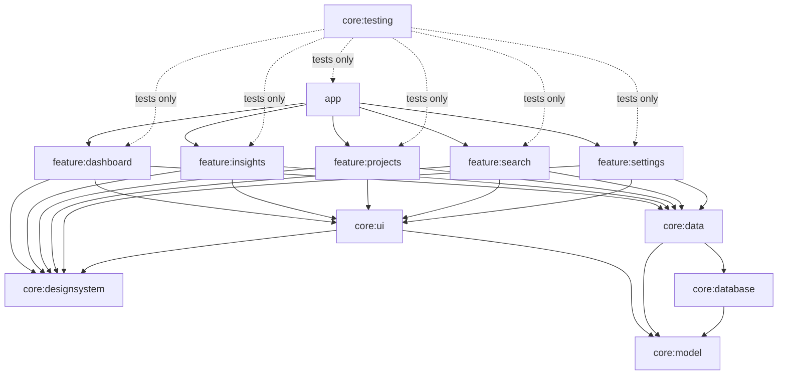

# PortProof architecture

## Principles

1. **Offline-first, local-only.** Room is the single source of truth. There is no backend, no
   account and no network code; the app does not request the `INTERNET` permission.
2. **Unidirectional data flow.** Repositories expose `Flow`s; ViewModels combine them into
   immutable UI state; composables render state and send events back as callbacks.
3. **Validated at the boundary.** Every user-entered value passes a validator in `core:model`
   before it can reach a repository (enforced by the type system, see below).
4. **Nothing pretends to work.** Navigation entries, buttons and menus exist only for features
   that are implemented.
5. **No silent data loss.** No destructive migrations, unsaved-change guards, confirmations for
   deletes, archive as the reversible alternative.

## Module structure

| Module | Responsibility | Depends on |
| --- | --- | --- |
| `core:model` | Domain types, stable persistence codes, validation, text sanitising. Pure Kotlin/JVM. | — |
| `core:database` | Room database, entities, DAOs, `LIKE` escaping, exported schemas | model |
| `core:data` | Repository interfaces and offline-first implementations, DataStore, `Clock` | database, model |
| `core:designsystem` | Theme tokens, Inter font, icon set, 3D emoji artwork, generic components (no domain types) | Compose |
| `core:ui` | Shared domain-aware UI: project card, status pill, activity row, artwork choice, greeting, formatting | designsystem, model |
| `core:testing` | Fakes for every repository, `MainDispatcherRule`, screenshot helper | data |
| `feature:*` | One screen family each: route, ViewModel, composables, navigation contract | core modules only |
| `app` | `Application`, `MainActivity`, navigation shell and graph | everything |

Rules: features never depend on each other (they navigate through callbacks wired in `app`);
only `core:data` sees `core:database`. Shared Gradle configuration lives in convention plugins
(`build-logic/convention`): `portproof.android.application`, `.library`, `.feature`, `.room`,
`.hilt`, `.jvm.library` and the two Compose plugins. A new feature module needs a three-line
build file.

## Layers and data flow

**Reads.** DAO queries return `Flow`s that re-emit on table changes. Repositories map entities to
domain models; ViewModels `combine` flows and expose `StateFlow<UiState>` via
`stateIn(viewModelScope, WhileSubscribed(5_000), initial)`; screens collect with
`collectAsStateWithLifecycle()`, so nothing is collected while the app is in the background.

**Writes.** Every mutation runs in one Room transaction together with its activity-log entry
(`OfflineFirstProjectRepository`). Mutations return `false` when the record no longer exists (for
example, deleted on another screen). Storage exceptions propagate to the ViewModel, which turns
them into a user message; the form keeps its contents so nothing typed is lost.

**Entities hold raw persisted values** (status codes, epoch days, epoch milliseconds). Conversion
happens in `core:data/mapper`, with safe fallbacks: an unknown status code becomes `PLANNED`, an
activity row with an unknown code is skipped, an out-of-range date becomes "not set". A corrupted
or newer-format row therefore degrades one field instead of crashing a whole screen.

**Time.** A `java.time.Clock` is injected wherever "now" matters, so tests control time. Day
bucketing (activity chart, "this month" counts) happens in Kotlin with the device time zone rather
than in SQL.

### ViewModel state

- Screen state that comes from the database is a `StateFlow`.
- Text-field state lives in Compose snapshot state inside the ViewModel (`mutableStateOf`), so the
  field updates synchronously while typing (avoids cursor jumps with asynchronous state). A
  `MutableStateFlow` mirror drives debounced search pipelines.
- Anything the user typed or selected is mirrored into `SavedStateHandle` (primitive keys only) and
  restored after process death. The project editor restores its form instead of reloading the
  stored record when it is recreated.
- One-off outcomes (saved, deleted, message to show) are modelled as state that the screen
  consumes and then acknowledges (`onSaveHandled()`, `onMessageShown()`), following the Android
  architecture guidance on UI events.

## Validation and input safety

- `ProjectValidator` turns raw `ProjectInput` into a `ProjectDraft`. `ProjectDraft`'s constructor
  is `internal` to `core:model`, so repositories can only receive validated data.
- `TextSanitizer` trims, collapses whitespace in single-line fields, normalises line endings, and
  removes control characters, bidirectional overrides and byte-order marks (these can disguise
  text in exported reports).
- Lengths are measured in Unicode code points. Too-long input is reported as a field error; it is
  never truncated silently.
- Date order is validated (completion date cannot precede the start date).
- Search input is escaped before it is used in `LIKE` patterns (`SqlLike`), so `%` and `_` match
  literally. All SQL uses bound parameters.

## Navigation

Navigation Compose 2.10 with `@Serializable` type-safe routes. Each feature module publishes its
routes plus `NavGraphBuilder` extensions; `app/navigation/PortProofNavHost.kt` wires them together.

| Route | Kind | Notes |
| --- | --- | --- |
| `HomeRoute` | Tab 1 (start) | Home screen |
| `ProjectsRoute(filter?)` | Tab 2 | Optional preselected filter from Home and Metrics cards |
| `SearchRoute` | Tab 3 | Global project search. Becomes the Equipment tab in Phase 2 |
| `MetricsRoute` | Tab 4 ("Insights") | Metrics Summary. Grows into Reports in Phase 4 |
| `SettingsRoute` | Tab 5 | |
| `InsightRoute` | Shared | Opened from Home's *See Details* and the *Due This Week* card |
| `ActivityLogRoute` | Shared | Opened from the bell on Home |
| `ProjectDetailRoute(projectId)` | Shared | Contextual project navigation starts here |
| `ProjectEditorRoute(projectId?)` | Shared | `null` = create. After creating, the editor is replaced by the detail screen |

The five-item bar follows the reference design. Its long-term layout (Home, Projects, Equipment,
Reports, Settings) is reached without ever showing an empty tab: Search hands its slot to
Equipment in Phase 2, and the Insights tab gains the report list in Phase 4. Project sections
(equipment, cabling, tests, defects, photos, report) are reached from the project detail screen,
and QR scans will deep-link to equipment and cable records.

Behaviour:

- Each top-level destination keeps its own back stack (`saveState`/`restoreState`). Home stays at
  the bottom of the stack, so Back from any tab returns to Home before leaving the app.
- Phones show the floating bar only on top-level screens; detail and editor screens get the full
  height for content. From 600dp a navigation rail is shown on every screen.
- Back buttons go through `PortProofAppState.navigateBack()`, which ignores a second tap during a
  transition so one tap never pops two screens.
- The editor intercepts Back (system gesture, button and close icon) while there are unsaved
  changes and asks before discarding. Predictive back is enabled
  (`android:enableOnBackInvokedCallback`).
- Deleting a project returns to the previous screen and shows a confirmation snackbar from the
  app shell, so the message survives leaving the deleted project's screen.

## Design system

The interface reproduces the second supplied reference design (three screens: home, "Insight" and
"Health Metrics Summary"), with its fitness content replaced by PortProof data:

| Reference element | PortProof implementation |
| --- | --- |
| Avatar, "Good Morning / Anna Santos", bell | Initials avatar (opens Settings), time-based greeting with the technician name, bell opens the activity log |
| Black "Workout Progress" card with ring and violet knob | `PpHeroProgressCard`: completion rate and open projects left |
| "Health Overview" emoji metric cards | `PpMetricCard`: active projects, projects due this week |
| "Popular Exercise" pastel cards with photo and "Start Now" | `PpFeatureCard`: the three most recently updated open projects, artwork chosen from the project name, "Open Project" pill; a final card starts a new project |
| Dark floating nav pill, violet selected circle | `PpFloatingNavBar`: Home, Projects, Search, Insights, Settings |
| "Insight" screen: Heart Rate bars, Hydration bar and rings, weekly target | Activity by hour (`PpBarChart`, busiest hours in green), completion (`PpProgressBar`, `PpRingRow`), upcoming deadlines |
| "Health Metrics Summary": black area chart, metric grid | `PpAreaChartCard` (updates per day, tap to inspect, info dialog), six project-count cards |

Deliberate differences: the reference uses stock photos of people (avatar and exercise cards);
PortProof has no licensed photography, so it uses an initials avatar and bundled 3D artwork
(Microsoft Fluent Emoji, MIT) that is identical on every device. The reference's system status bar
and device frames are not part of the app.

Tokens (`core/designsystem/theme`): `PortProofColors` (white canvas and cards with hairline borders,
near-black hero cards and pill buttons, violet accent `#7B3FF2`, pastel lavender/lime/sky/peach
feature cards, pink/green and blue chart colours), `PortProofTypography` (Inter, Regular and Medium
weights as in the reference, tabular figures), `PortProofSpacing` and `PortProofShapes` (20dp cards,
22dp hero cards, 24dp feature cards, pill buttons). The dark theme keeps the same structure on
graphite surfaces, lifts hero cards and the nav bar so they stay distinct, and inverts pill buttons
to white. The Material 3 scheme is derived from the same tokens; dynamic colour is off. Every
content text/background pair meets WCAG AA (4.5:1); the reference's lighter grey (`#8E8E93`,
3.3:1) was darkened to `#636368`/`#6A6A6F` to meet it.

Components: `PpCard`, `PpPanel`, `PpIconTile`, `PpEmojiBadge`, `PpHeroProgressCard`,
`PpProgressRing`, `PpMetricCard`, `PpFeatureCard`, `PpInsightCard`, `PpBarChart`, `PpProgressBar`,
`PpRingRow`, `PpAreaChartCard`, `PpHatchedProgressBar`, `PpPrimaryButton`, `PpSecondaryButton`,
`PpPillButton`, `PpTextLink`, `PpChipButton`, `PpIconButton`, `PpAvatarButton`, `PpTextField`,
`PpPickerField`, `PpSearchField`, `PpSegmentedControl`, `PpSectionHeader`, `PpStatusPill`,
`PpFloatingNavBar`, `PpNavigationRail`, `PpTopBar` (centred title), `PpListRow`, `PpEmptyState`,
`PpConfirmDialog`. Icons: a curated Lucide set generated into `PortProofIcons` (`tools/icons`);
artwork: `PpEmoji` and `PpIllustration` (`tools/emoji`).

### Adaptive layout and accessibility

- Widths below 600dp: single column and the floating bar. 600–840dp: navigation rail, single
  column, content capped at 880dp. From 840dp: rail and a two-column Home (progress and overview
  beside the project cards).
- Touch targets are at least 48dp (icon buttons draw a 44dp circle inside a 48dp target).
- Section titles are marked as headings; the progress ring and every chart expose a text summary to TalkBack;
  status is never shown by colour alone; text fields announce validation errors.
- All strings are resources, with plurals where counts appear.

## Error handling

| Situation | Behaviour |
| --- | --- |
| Invalid input | Inline field errors plus a snackbar; nothing is written |
| Write fails (disk full, I/O error) | Snackbar "Couldn't save your changes"; the form keeps its contents |
| Record deleted while open | Detail and editor screens show "Project not found" |
| Unknown or corrupted persisted value | Safe fallback per field (see "Layers and data flow") |
| Preferences file unreadable or corrupted | Defaults are used; a corrupted file is replaced |
| Corrupted database file | **Open issue:** the framework's default handler deletes it. A handler that preserves the file and offers a restore from backup is planned with Phase 4 |

## Security and privacy

- **Permissions:** none in Phase 1 (merged manifest checked). `CAMERA` arrives in Phase 2 and is
  requested only when the user opens the scanner or camera. Photo import will use the system photo
  picker, which needs no storage permission.
- **Storage:** the database and preferences live in app-private storage. Photos, reports and
  exports (later phases) will use app-private `files/`, shared only through `FileProvider` URIs
  or files the user explicitly saves through the Storage Access Framework.
- **Backups:** `data_extraction_rules.xml` (Android 12+) and `backup_rules.xml` (Android 8–11)
  include the database and preferences in cloud backup only when it is end-to-end encrypted, and
  everything in device-to-device transfer. Photos will be excluded from cloud backup because of
  size; the in-app backup (Phase 4) covers them.
- **Logging:** customer data, addresses and serial numbers must never be logged. Phase 1 contains
  no logging at all; release builds strip `Log.v/d/i` with R8 as a safety net.
- **QR codes** (Phase 2) will carry only an opaque record identifier, never customer data.
- **Release hardening:** R8 minification and resource shrinking are enabled for release builds.
  Release signing keys are kept out of the repository.

## Toolchain and compatibility

Versions were checked on 2026-11-01 against Google Maven, Maven Central and the published
compatibility tables, then verified by building and testing in this repository.

| Component | Version | Why this version |
| --- | --- | --- |
| Android Gradle Plugin | 9.3.3 | Supports compile SDK 37; newest AGP line inside Kotlin 2.4.21's documented compatibility range (AGP ≤ 9.3.1, patch releases included). AGP 9.4/9.5 exist and are evaluated in Phase 5 |
| Gradle | 9.7.1 (wrapper with SHA-256) | AGP 9.3 needs ≥ 9.5.0; KGP 2.4.21 is fully supported up to 9.7 |
| Kotlin (KGP, Compose compiler, serialization plugin) | 2.4.21 | Uses AGP 9 built-in Kotlin; declared at the root to replace AGP's default KGP 2.2.10 |
| KSP | 2.3.13 | Includes the fix for Kotlin 2.4 module names (google/ksp#2964) |
| Hilt | 2.60.1 | Hilt 2.59+ is required for AGP 9; 2.60 reads Kotlin 2.4 metadata (google/dagger#5177) |
| Room | 2.8.5 | `withTransaction` now ships in `room-runtime` |
| Compose BOM | 2026.09.00 (UI 1.12.1, Material 3 1.4.0) | Requires compile SDK 37 and AGP ≥ 9.1 |
| Navigation Compose | 2.10.2 | Type-safe routes, multiple back stacks |
| Lifecycle / Activity / Core | 2.11.0 / 1.13.0 / 1.19.1 | Core 1.19 requires compile SDK 37 |
| AndroidX Hilt (`hiltViewModel`) | 1.4.0 | `androidx.hilt.lifecycle.viewmodel.compose` |
| DataStore Preferences | 1.3.0 | |
| Coroutines / Serialization | 1.11.0 / 1.12.0 | Serialization 1.12 is built on Kotlin 2.4.10 |
| Robolectric | 4.17 | Supports SDK 37; tests run on SDK 36 |
| JDK | 17+ (bytecode target 17) | Build and tests verified on JDK 21 |

SDK levels: min 26 (`java.time` without desugaring, ~97% of active devices), target 36 (required
by Google Play for new apps and updates since 31 August 2026), compile 37.

Planned for later phases (versions current on 2026-11-01, re-checked when adopted):
CameraX 1.6.2, ML Kit `barcode-scanning` 17.3.0 (bundled model, works offline), ZXing `core`
3.5.4 (QR generation; ML Kit only decodes), WorkManager 2.12.0 with `androidx.hilt:hilt-work`.
PDF uses the framework `PdfDocument`; CSV and backup archives use the standard library.

Robolectric on JDK 17+ needs `--add-opens` flags; they are set in the convention plugin for all
unit-test tasks.

## Architecture decision records

**ADR-001 Multi-module build with convention plugins.** Features and core layers are separate
Gradle modules so boundaries are enforced by the compiler and builds stay incremental as ten more
feature areas arrive. Cost: more build files, kept small by `build-logic`.

**ADR-002 Navigation Compose 2.x rather than Navigation 3.** Navigation 2.10 provides multiple
back stacks, deep links (needed for QR scanning) and `SavedStateHandle` arguments out of the box.
Navigation 3 would require building those ourselves. Revisit when adaptive list-detail layouts
for tablets become a priority.

**ADR-003 Platform SQLite, SQL kept compatible with SQLite 3.18.** The bundled SQLite driver would
add native libraries and complicate JVM tests. Queries therefore avoid `NULLS LAST`, window
functions, `FILTER` and `UPSERT` syntax (all newer than Android 8.0's SQLite).

**ADR-004 UUID text primary keys.** Identifiers are not guessable or sequential, survive backup
and restore without renumbering, and can go into QR codes. The activity log uses an autoincrement
key because it is never referenced externally.

**ADR-005 Raw values in entities, conversion in the data layer.** See "Layers and data flow".
Room never throws on an unexpected enum value, and codes can evolve without TypeConverters.

**ADR-006 Bundled Inter font, generated Lucide icons and bundled 3D emoji.** Downloadable fonts
fail offline on first launch, and `material-icons-extended` is very large and has a heavier style
than the reference. Emoji are bundled as images because vendor emoji fonts differ between devices
and Android versions. Together they add about 1.7 MB to the APK (fonts 1.6 MB, artwork 0.1 MB).

**ADR-007 Validation types.** Only `ProjectValidator` can create a `ProjectDraft`, so unvalidated
input cannot be persisted by mistake.

**ADR-008 No placeholder tabs.** Every tab opens a working screen. The reference's five-item bar is
filled with Home, Projects, Search, Insights and Settings; Search becomes Equipment in Phase 2 and
Insights gains Reports in Phase 4, rather than shipping empty Equipment and Reports tabs now.

**ADR-009 Cascade deletes behind explicit confirmation (planned schema).** Ownership relations
cascade at database level so no orphan rows can exist; the UI states exactly what will be deleted
and offers archiving instead. See DATABASE_SCHEMA.md for the per-relation rules.

**ADR-010 Logical backup format (Phase 4).** Backups will be a ZIP with a versioned JSON export
plus photo files, imported through repositories in a transaction. This avoids swapping the live
SQLite file under an open Room instance and lets older backups restore into newer schema versions.
