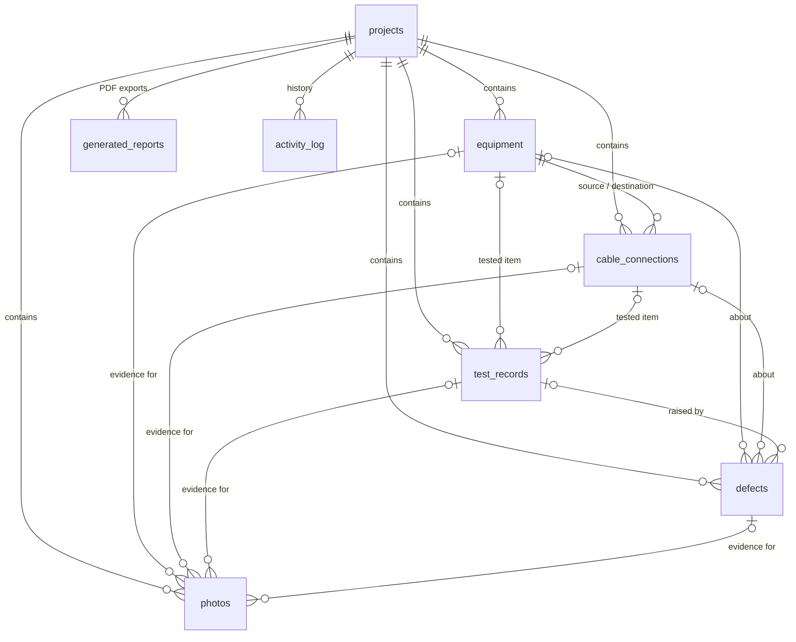

# PortProof database schema

Room database `portproof.db` (`core/database`). Current version: **1** (Phase 1). Exported schema
JSON: [`core/database/schemas/`](core/database/schemas/), committed for every version.

## Conventions

| Topic | Rule |
| --- | --- |
| Primary keys | UUID strings (`TEXT`); the activity log uses an autoincrement `INTEGER` |
| Timestamps | Epoch milliseconds, UTC (`INTEGER`), columns named `*_at` |
| Calendar dates | Epoch day (`INTEGER`), e.g. `start_date` |
| Enumerations | Stable upper-case codes stored as `TEXT` (`ProjectStatus.code`); never the Kotlin enum name |
| Names | `snake_case` tables and columns |
| Foreign keys | Declared on every relation; Room enables `PRAGMA foreign_keys` |
| SQL dialect | Compatible with SQLite 3.18 (Android 8.0); see ARCHITECTURE.md ADR-003 |
| Migrations | Every schema change bumps the version and ships a migration (auto-migration where possible) with a migration test. Destructive fallback is never enabled |
| Sensitive data | Customer name and site address live only in `projects`. Serial numbers (Phase 2) live only in `equipment`. Neither is copied into logs or the activity log |

## Version 1 (implemented)

### `projects`

| Column | Type | Null | Notes |
| --- | --- | --- | --- |
| `id` | TEXT | no | PK, UUID |
| `name` | TEXT | no | 1–120 characters |
| `reference` | TEXT | yes | Project or PO reference, ≤ 64 |
| `customer_name` | TEXT | yes | ≤ 120 |
| `site_name` | TEXT | yes | ≤ 120 |
| `site_address` | TEXT | yes | Multi-line, ≤ 500 |
| `description` | TEXT | yes | Multi-line, ≤ 4000 |
| `status` | TEXT | no | `PLANNED`, `IN_PROGRESS`, `ON_HOLD`, `COMPLETED` |
| `start_date` | INTEGER | yes | Epoch day |
| `end_date` | INTEGER | yes | Epoch day, ≥ `start_date` (validated in the domain layer) |
| `created_at` | INTEGER | no | |
| `updated_at` | INTEGER | no | Changes only when a value actually changes |
| `completed_at` | INTEGER | yes | Set when status becomes `COMPLETED`, kept while it stays completed, cleared when reopened |
| `archived_at` | INTEGER | yes | `NULL` = not archived |

Indices: `(archived_at, updated_at)` for list screens, `(status)` for counts.
Length limits are enforced by `ProjectValidator` (code points), not by SQL.

### `activity_log`

| Column | Type | Null | Notes |
| --- | --- | --- | --- |
| `id` | INTEGER | no | PK, autoincrement |
| `project_id` | TEXT | yes | FK → `projects.id`, **ON DELETE CASCADE** |
| `entity_type` | TEXT | no | `PROJECT` (Phase 2+: `EQUIPMENT`, `CONNECTION`, `TEST`, `DEFECT`, `PHOTO`, `REPORT`) |
| `entity_id` | TEXT | yes | ID of the affected record |
| `action` | TEXT | no | `CREATED`, `UPDATED`, `STATUS_CHANGED`, `ARCHIVED`, `RESTORED` |
| `label` | TEXT | yes | Display-name snapshot for child records (for example an equipment name). Never customer data |
| `detail` | TEXT | yes | Machine-readable code, e.g. the new status for `STATUS_CHANGED` |
| `occurred_at` | INTEGER | no | |

Indices: `(project_id, occurred_at)`, `(occurred_at)`. The project name shown in the feed is
joined at query time, so renaming a project updates its history. Deleting a project removes its
activity; the app does not keep "deleted project" entries.

### Derived queries

- **Dashboard counts:** one aggregate query (`ProjectDao.observeCounts`) using
  `SUM(CASE …)`. Totals exclude archived projects; *active* = not archived and not completed.
- **Free-plan limit** (`ProjectDao.countActive`): the number of active projects (not archived, not
  completed), read inside the same transaction as each write that would add one (create, reopen,
  restore). See ARCHITECTURE.md, "Plan limit".
- **Search:** `LIKE '%…%' ESCAPE '\'` over name, reference, customer, site name (and address for
  global search). User input is escaped first (`SqlLike`). `COLLATE NOCASE` folds ASCII only;
  accent-insensitive search would need an FTS table (candidate for Phase 5).
- **Deadlines** (`ProjectDao.observeDeadlines`): open, non-archived projects with `end_date` on or
  before a given day, earliest first, so overdue projects lead. Used for the Overview's *Upcoming
  deadlines*. No index on `end_date` yet; add one if project counts reach the thousands.
- **Activity insights:** one query returns the timestamps of the last 14 days; daily counts, the
  previous-period total, the hour-of-day histogram and today's count are all computed from it in
  Kotlin with the device time zone (`OfflineFirstActivityRepository.observeActivityInsights`).
- **Sorting:** `CASE` expressions in `ORDER BY` because column names cannot be bound parameters;
  null start dates sort last through `(start_date IS NULL)`.

### Other stored files (DataStore Preferences)

Settings and security state that is not relational lives in three DataStore files under
`files/datastore/`. A corrupted file is replaced by an empty one (defaults apply).

| File | Keys | Backup |
| --- | --- | --- |
| `user_preferences` | `technician_name`, `company_name`, `theme_mode` | Cloud (encrypted only) and device transfer |
| `app_lock` | `pin_hash`, `pin_salt` (Base64), `pin_iterations`, `failed_attempts`, `locked_until` (epoch ms), `biometric_enabled`. The PIN itself is never stored | Excluded from both |
| `billing` | `pro_active` (result of the last Google Play check), `debug_pro_override` (read only in debug builds) | Excluded from both |

## Planned schema (Phases 2–4)

### Version 2 (Phase 2): `equipment`, `cable_connections`

**`equipment`**: `id` PK · `project_id` FK CASCADE · `name` · `category` (code: `CAMERA`,
`NVR_DVR`, `SWITCH`, `ROUTER`, `FIREWALL`, `ACCESS_POINT`, `PATCH_PANEL`, `ACCESS_CONTROLLER`,
`READER`, `LOCK`, `POWER_SUPPLY`, `UPS`, `DISPLAY`, `AUDIO`, `SERVER`, `RACK`, `OTHER`) ·
`manufacturer?` · `model?` · `serial_number?` · `location?` · `ip_address?` (validated IPv4/IPv6) ·
`mac_address?` (normalised `AA:BB:CC:DD:EE:FF`) · `port_count?` (drives the port-grid view) ·
`notes?` · `status` (`PLANNED`, `INSTALLED`, `CONFIGURED`, `COMMISSIONED`, `FAULTY`, `REMOVED`) ·
`created_at` · `updated_at`.
Indices: unique `(project_id, id)` (target of composite foreign keys), `(project_id, name)`.

**`cable_connections`**: `id` PK · `project_id` FK CASCADE · `cable_label` (cable identifier) ·
`cable_type` (`CAT5E`, `CAT6`, `CAT6A`, `CAT7`, `FIBRE_OM3`, `FIBRE_OM4`, `FIBRE_OS2`, `COAX`,
`HDMI`, `ALARM`, `POWER`, `SPEAKER`, `OTHER`) · `source_equipment_id` · `source_port?` ·
`destination_equipment_id` · `destination_port?` · `vlan?` (1–4094) · `length_m?` · `status`
(`PLANNED`, `INSTALLED`, `TERMINATED`, `TESTED`, `FAULTY`) · `notes?` · `created_at` · `updated_at`.

- Composite foreign keys `(project_id, source_equipment_id)` and
  `(project_id, destination_equipment_id)` → `equipment(project_id, id)` ON DELETE CASCADE. The
  database itself rejects references to equipment that does not exist **or belongs to another
  project**.
- Unique index `(project_id, cable_label COLLATE NOCASE)`: cable identifiers are unique per project.
- Port reuse (the same equipment and port on two connections) produces a warning that the user can
  confirm, because patch-panel ports legitimately carry a front and a rear cable. The check runs in
  the same transaction as the write.
- Migration 1 → 2 only adds tables, so it is a Room auto-migration plus a migration test.

### Version 3 (Phase 3): `test_records`, `defects`, `photos`

**`test_records`**: `id` · `project_id` FK CASCADE · `equipment_id?` / `connection_id?` (composite
FKs with `project_id`, CASCADE; at most one is set) · `name` · `tested_on` (epoch day) ·
`technician?` · `measured_value?` (REAL) · `unit?` · `expected_value?` · `result` (`PASS`, `FAIL`,
`NOT_TESTED`) · `notes?` · timestamps. These are user-entered records; the UI and reports never
describe them as independently verified.

**`defects`**: `id` · `project_id` FK CASCADE · `equipment_id?` / `connection_id?` / `test_id?`
(simple FKs, **ON DELETE SET NULL**: a defect outlives the item it was about, for example after a
faulty camera is replaced) · `subject_label?` (snapshot of the item name) · `title` ·
`description?` · `severity` (`LOW`, `MEDIUM`, `HIGH`, `CRITICAL`) · `status` (`OPEN`,
`IN_PROGRESS`, `RESOLVED`, `WONT_FIX`) · `resolution_notes?` · `created_at` · `resolved_at?` ·
`updated_at`. Simple keys are used here because `SET NULL` on a composite key would also null
`project_id`; same-project integrity for these links is checked in the repository transaction.

**`photos`**: `id` · `project_id` FK CASCADE · `equipment_id?` / `connection_id?` / `test_id?` /
`defect_id?` (FKs CASCADE; at most one is set; none = general site photo) · `file_name` (relative
path under app-private `files/photos/`) · `caption?` · `taken_at?` · `width`, `height`,
`size_bytes`, `mime_type` · `include_in_report` · `created_at`. Image files are deleted after the
database transaction commits, and a WorkManager job removes any file no row references.

### Version 4 (Phase 4): `generated_reports`

`id` · `project_id` FK CASCADE · `file_name` (app-private `files/reports/`) · `generated_at` ·
`page_count` · `size_bytes` · `options` (JSON: sections and photos included). Lists previous PDF
handovers on the Reports tab; files are shared through `FileProvider`.

## Delete behaviour

| Deleting… | Effect |
| --- | --- |
| Project | Everything under it is removed (cascade), then its photo and report files. The UI requires confirmation and offers Archive instead |
| Equipment | Its connections, tests and photos are removed (cascade); defects stay on the project with the item name snapshot (`SET NULL`). The confirmation lists the counts first |
| Cable connection | Its tests and photos are removed; defects stay (`SET NULL`) |
| Test record | Its photos are removed; defects stay (`SET NULL`) |
| Defect / photo | Only that record (and the photo file) |

## Integrity rules enforced in the app layer

Room entities cannot declare `CHECK` constraints, and SQLite constraints cannot express
cross-table conditions, so these rules live in validators and repository transactions:

- Text lengths and formats (names, IP and MAC addresses, VLAN range): validators in `core:model`.
- At most one owner column set on `photos` and `test_records`.
- Same-project checks for `SET NULL` links on `defects`.
- Port-reuse warning for cable connections.

## Testing the schema

`ProjectDaoTest` (Robolectric, in-memory database) covers filters, sorting, `LIKE` escaping,
aggregate counts, cascade deletes, foreign-key enforcement and the activity join. From version 2,
every migration gets a `MigrationTestHelper` test against the exported schema JSON.
