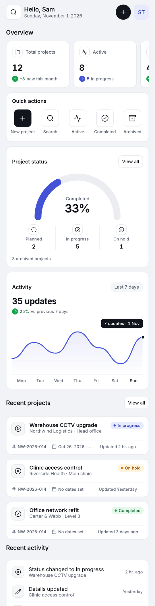
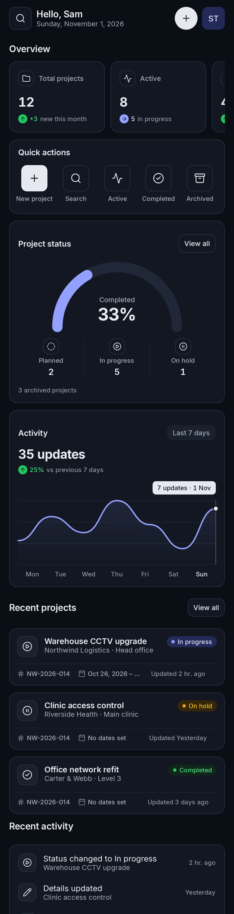
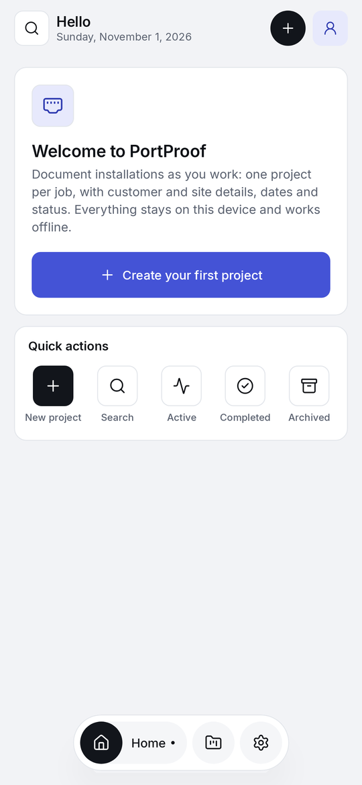
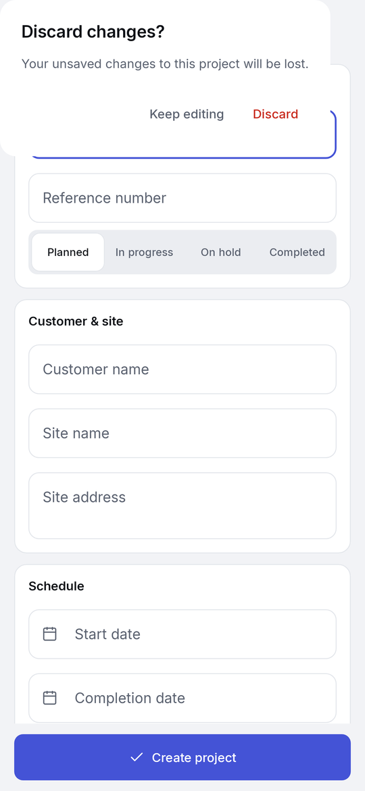
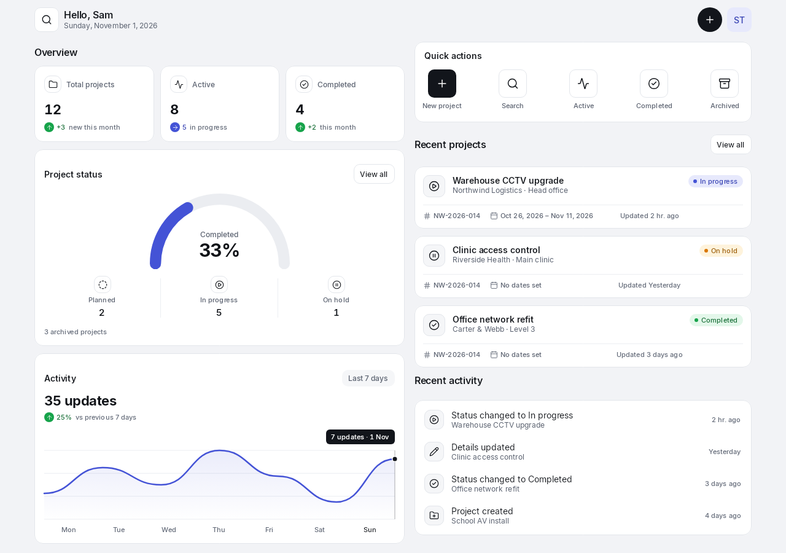

# PortProof

PortProof is a native Android app for documenting technical installations on site: projects,
equipment, cable and port mapping, commissioning tests, defects, photo evidence and the PDF
handover pack. It is built for CCTV, network cabling, access control, AV and low-voltage
installers, and works fully offline with no account.

> Repository: `Rackfolio` (working repository name). Product name: **PortProof**.

## Status

**Phase 1 of 5 is complete** (foundation, design system, navigation, dashboard, projects).
See [DEVELOPMENT_ROADMAP.md](DEVELOPMENT_ROADMAP.md) for what comes next.

What works today:

- Dashboard with project totals, active/completed counts, a completion gauge, a 7-day activity
  chart, recent projects, recent activity, quick actions and search.
- Projects: create, edit, change status, archive/restore (with undo), delete with confirmation.
  Fields: name, reference number, customer, site name and address, start/completion dates,
  description, status.
- Project list with filters (All, Active, Completed, Archived), sorting and text search.
- Global project search (includes archived projects).
- Settings: technician and company name, light/dark/system theme, privacy information.
- Room persistence with an activity log, validation of every input, unsaved-change protection,
  and form state that survives process death.
- Phone layout with a floating navigation bar; navigation rail and two-column dashboard on
  tablets and unfolded foldables.

Equipment, cabling, QR codes, tests, photos, defects, PDF/CSV export and backup are **not built
yet**; they arrive in Phases 2–4. Their tabs are added to the navigation bar only when they work.

## Screenshots

Rendered by the Robolectric tests (`docs/screenshots/`), not captured on a device.

| Dashboard (light) | Dashboard (dark) | Project detail | Projects |
| --- | --- | --- | --- |
|  |  |  |  |

| First run | Editor validation | Discard guard | Tablet |
| --- | --- | --- | --- |
|  |  |  |  |

## Tech stack

Kotlin 2.4, Jetpack Compose (Material 3), MVVM with the repository pattern, Room, Coroutines and
Flow, Hilt, DataStore, Navigation Compose with type-safe routes. Later phases add CameraX, ML Kit
barcode scanning, `PdfDocument`, WorkManager and the Storage Access Framework.
Exact versions and the reasoning behind them are in
[ARCHITECTURE.md](ARCHITECTURE.md#toolchain-and-compatibility).

| | |
| --- | --- |
| Min SDK | 26 (Android 8.0) |
| Target SDK | 36 (Android 16, the current Google Play requirement) |
| Compile SDK | 37 |
| JDK | 17 or newer (builds and tests were verified with JDK 21) |

## Building

Requirements: JDK 17+, Android SDK with *Android SDK Platform 37* and *Build-Tools 36.0.0*, and an
Android Studio release that supports AGP 9.3.

```bash
./gradlew assembleDebug                       # debug APK (app/build/outputs/apk/debug)
./gradlew :core:model:test testDebugUnitTest  # all unit, Robolectric and UI-flow tests
./gradlew lintDebug                           # Android Lint, all modules
./gradlew assembleRelease                     # minified, unsigned release APK
```

The debug build installs as `com.portproof.app.debug`, so it can sit next to a release build.
Release signing is not configured in the repository by design (see Phase 5).

## Project structure

```
app/                  Application, MainActivity, navigation shell (bar/rail), nav graph
core/model            Pure Kotlin domain model and validation (no Android)
core/database         Room database, entities, DAOs, exported schemas
core/data             Repositories (offline-first), DataStore preferences, DI bindings
core/designsystem     Theme tokens, Inter font, icon set, reusable components
core/ui               Domain-aware shared UI (project card, status pill, activity row)
core/testing          Test fakes, dispatcher rule, screenshot helper
feature/dashboard     Home dashboard
feature/projects      Project list, detail and editor
feature/search        Global search
feature/settings      Settings
build-logic/          Gradle convention plugins (shared module configuration)
tools/icons           Icon generator (Lucide SVG -> Compose ImageVector)
```

## Documentation

- [ARCHITECTURE.md](ARCHITECTURE.md): modules, layers, navigation, design system, security,
  toolchain and architecture decisions
- [DATABASE_SCHEMA.md](DATABASE_SCHEMA.md): current schema (v1) and the planned schema for all phases
- [DEVELOPMENT_ROADMAP.md](DEVELOPMENT_ROADMAP.md): phases, open issues, technical risks
- [TESTING.md](TESTING.md): test strategy, how to run tests, current results
- [THIRD_PARTY_NOTICES.md](THIRD_PARTY_NOTICES.md): bundled font and icon licences

## Privacy

PortProof has no backend, no account and no internet permission. Data is stored in app-private
storage on the device. Android's own device backup may include the project database (end-to-end
encrypted backups only); see [ARCHITECTURE.md](ARCHITECTURE.md#security-and-privacy).
