# PortProof

PortProof is a native Android app for documenting technical installations on site: projects,
equipment, cable and port mapping, commissioning tests, defects, photo evidence and the PDF
handover pack. It is built for CCTV, network cabling, access control, AV and low-voltage
installers. It works fully offline, with no account and no PortProof server.

> Repository: `Rackfolio` (working repository name). Product name: **PortProof**.

## Status

**Phase 1 of 5 is complete** (foundation, design system, navigation, dashboard, projects). Phase 1d
added the login (a PIN app lock), the PortProof Pro subscription page and the interface of the
fourth reference design. See [DEVELOPMENT_ROADMAP.md](DEVELOPMENT_ROADMAP.md) for what comes next.

What works today:

- **Login:** on first start, three welcome pages, then your name (company optional), a 6-digit PIN
  entered twice and, if the phone has a fingerprint (or another strong biometric) set up, the offer
  to unlock with it. PortProof asks for the PIN each time it starts and after 5 minutes in the
  background. The 5th wrong PIN in a row starts a 30-second wait, which doubles with each further
  wrong PIN up to 16 minutes. There is no account, so a forgotten PIN can't be recovered: *Forgot
  PIN?* offers to erase all PortProof data. *Login & security* in Settings changes the PIN, turns
  fingerprint unlock on or off and locks the app at once.
- **Home** (layout of the reference dashboard): calendar and bell buttons around the *Dashboard*
  title (active projects by start date; recent activity), a segmented gauge of completed projects
  out of all projects that aren't archived, a wide *+* bar for a new project, and the three most
  recently updated projects with an edit button.
- **Bottom bar:** Home, Projects, Search (the orange square in the centre), Overview and Settings.
  Each tab keeps its place; Back from a tab returns to Home.
- **Project cards:** status, customer and site, last update, a schedule figure (share of the
  schedule elapsed with "Day 12 of 20", days until the start, days overdue, or 100% when
  completed), and the start date, due date and status.
- **Projects tab:** search field, sort menu (recently updated, name, start date), category tiles
  (All, Active, Completed, Archived) and the matching list with a count badge and *New project*.
- **Project detail** (peach header screen): status card with the schedule and a 5-step progress bar
  (tap to change status), and a *Project record* card. Rule-based checks highlight gaps in the
  record: yellow for a missing customer, site or dates (or an archived project), red for an overdue
  completion date, orange for a project due within 7 days or on hold. These are fixed rules, not AI.
  *Edit project* and a *…* menu (archive/restore, delete) sit at the bottom.
- **Projects:** create, edit, change status, archive/restore (with undo), delete with confirmation.
  Fields: name, reference number, customer, site name and address, start/completion dates,
  description, status.
- **Search:** global project search, including archived projects.
- **Overview:** project counts that open the matching list, upcoming and overdue completion dates,
  and recent activity with *See all* for the full activity log.
- **PortProof Pro** (subscription page): the free plan includes 3 active projects (completed and
  archived projects don't count); Pro removes the limit. Monthly and yearly plans with the prices
  and free trials Google Play reports, *Restore purchases*, and *Manage in Google Play* once
  subscribed. At the limit, the editor and project detail say so and link to Pro; existing projects
  are never locked or hidden.
- **Settings:** plan, Login & security, technician and company name, light/dark/system theme,
  privacy information.
- Room persistence with an activity log, validation of every input, unsaved-change protection,
  and form state that survives process death.
- Light and dark themes. On tablets and in landscape, content sits in a centred column.

Equipment, cabling, QR codes, tests, photos, defects, PDF/CSV export and backup are **not built
yet**; they arrive in Phases 2–4. The centre bar button opens Search until the QR scanner exists.

### PortProof Pro needs a Play Console setup

Purchases only work in a build installed from Google Play, for an app with this product in Play
Console:

| Play Console item | Value |
| --- | --- |
| Subscription product ID | `portproof_pro` |
| Base plans | Two auto-renewing plans, billed every month and every year (suggested IDs `monthly` and `yearly`; the app recognises them by billing period) |
| Free trial (optional) | An offer on either base plan; the app shows it to eligible users |
| Testing | Licence testers and an internal testing track |

Until then the Pro page explains that plans aren't available and the free plan applies. Debug
builds have a *Treat this device as Pro* switch on the Pro page for testing; release builds don't.
Real purchases have not been tested yet (see [TESTING.md](TESTING.md)).

## Screenshots

Rendered by the Robolectric tests (`docs/screenshots/`), not captured on a device.

| Welcome | Create PIN | Login | Login & security |
| --- | --- | --- | --- |
| 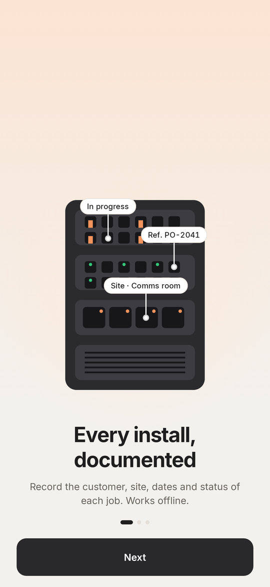 | 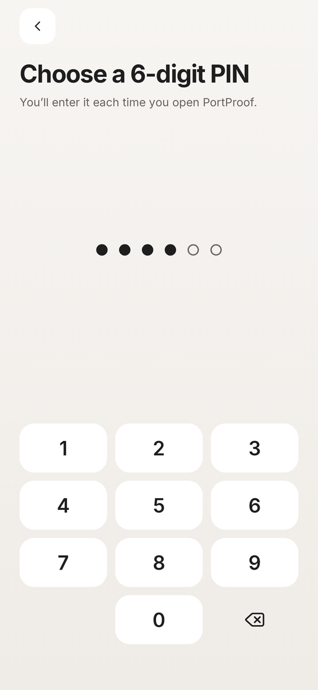 | 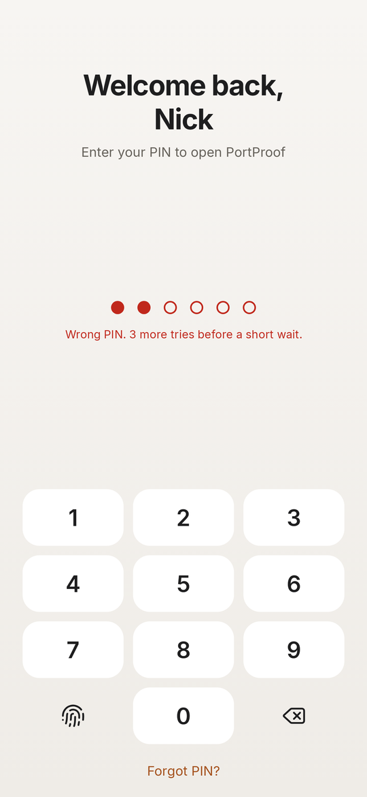 | 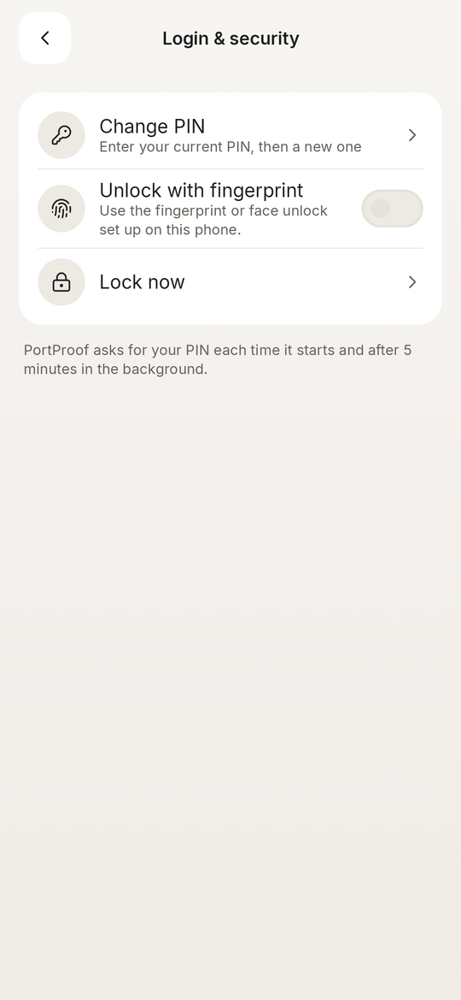 |

| Home | Home (dark) | Projects | Project detail |
| --- | --- | --- | --- |
|  |  |  |  |

| Search | Overview | Settings | PortProof Pro |
| --- | --- | --- | --- |
| 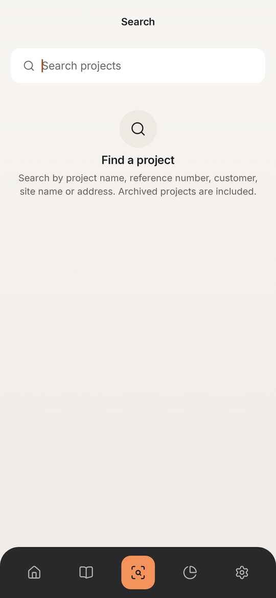 |  | 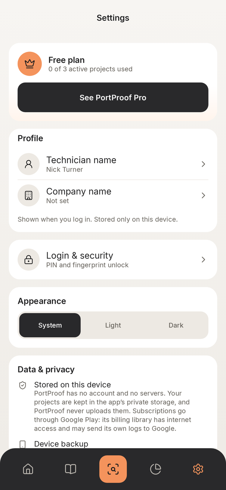 | 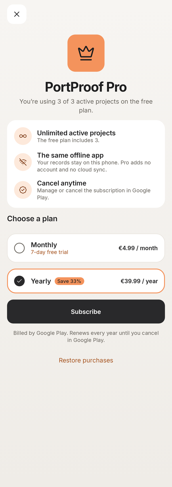 |

| Free-plan limit | Editor validation | Pro (dark) | Login (dark) |
| --- | --- | --- | --- |
| 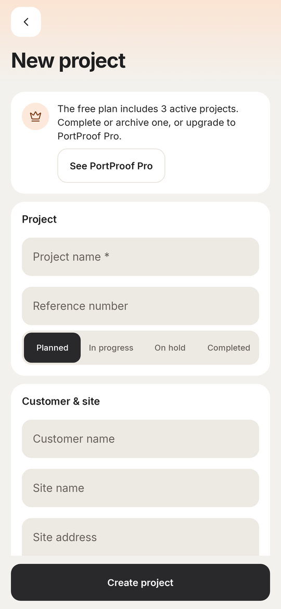 | 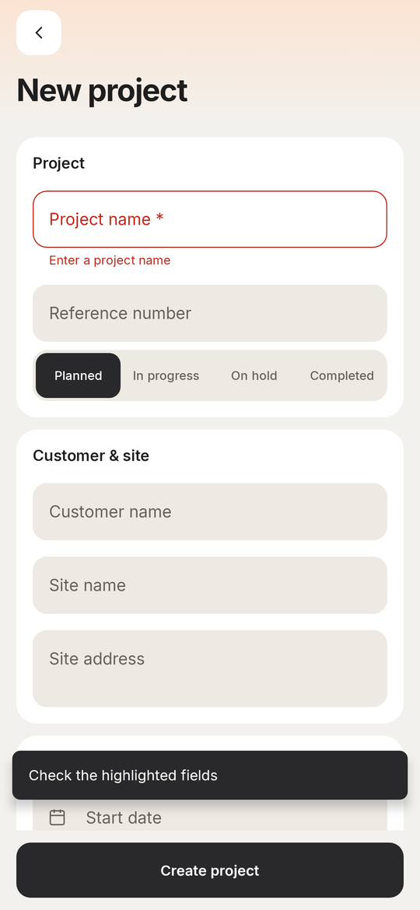 | 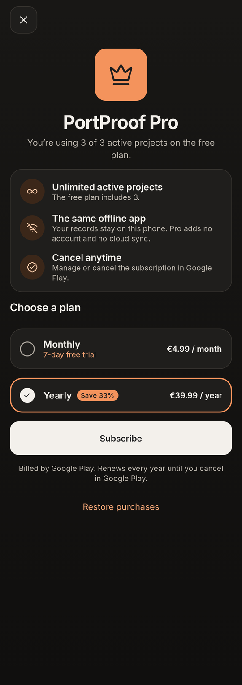 | 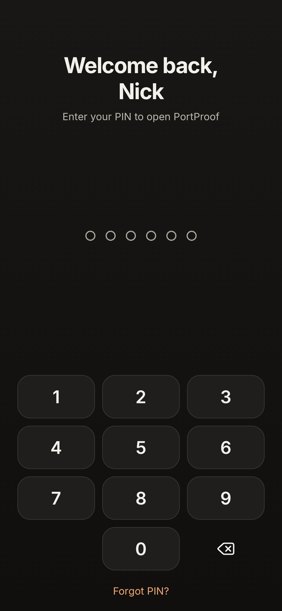 |

Also rendered: welcome pages [2](docs/screenshots/login_welcome_2.png) and
[3](docs/screenshots/login_welcome_3.png), [welcome (dark)](docs/screenshots/login_welcome_dark.png),
[fingerprint offer](docs/screenshots/login_fingerprint.png),
[first run](docs/screenshots/home_first_run.png),
[detail (dark)](docs/screenshots/project_detail_dark.png),
[overview (dark)](docs/screenshots/overview_dark.png),
[activity log](docs/screenshots/activity_log.png), [Pro active](docs/screenshots/pro_active.png),
[Pro unavailable](docs/screenshots/pro_unavailable.png), [tablet](docs/screenshots/home_tablet.png)
and the [discard dialog](docs/screenshots/discard_dialog.png) (the capture draws dialog windows at
the top of the screen without the dimmed background; on a device the dialog is centred).

## Tech stack

Kotlin 2.4, Jetpack Compose (Material 3), MVVM with the repository pattern, Room, Coroutines and
Flow, Hilt, DataStore, Navigation Compose with type-safe routes, Google Play Billing Library 9 and
androidx.biometric. Later phases add CameraX, ML Kit barcode scanning, `PdfDocument`, WorkManager
and the Storage Access Framework. Exact versions and the reasoning behind them are in
[ARCHITECTURE.md](ARCHITECTURE.md#toolchain-and-compatibility).

| | |
| --- | --- |
| Min SDK | 26 (Android 8.0) |
| Target SDK | 36 (Android 16, the current Google Play requirement) |
| Compile SDK | 37 |
| JDK | 17 or newer (builds and tests were verified with JDK 21) |

## Building

Requirements: JDK 17+, Android SDK with *Android SDK Platform 37* and *Build-Tools 36.0.0*, and an
Android Studio release that supports AGP 9.3.

```bash
./gradlew assembleDebug                       # debug APK (app/build/outputs/apk/debug)
./gradlew :core:model:test testDebugUnitTest  # all unit, Robolectric and UI-flow tests
./gradlew lintDebug                           # Android Lint, all modules
./gradlew assembleRelease                     # minified, unsigned release APK
```

The debug build installs as `com.portproof.app.debug`, so it can sit next to a release build.
Release signing is not configured in the repository by design (see Phase 5).

## Project structure

```
app/                  Application, MainActivity (login gate), app shell (bottom bar, snackbars), nav graph
core/model            Pure Kotlin domain model, validation, plan and app-lock rules (no Android)
core/database         Room database, entities, DAOs, exported schemas
core/data             Repositories (offline-first), DataStore, PIN hashing, app-lock session, DI bindings
core/billing          Google Play Billing: Pro subscription, cached plan
core/designsystem     Theme tokens, Inter font, icon set, reusable components
core/ui               Domain-aware shared UI (project card, status labels, activity row, formatting)
core/testing          Test fakes, dispatcher rule, screenshot helper
feature/dashboard     Home screen
feature/projects      Projects tab, project detail and editor
feature/search        Global search
feature/insights      Overview, activity log
feature/settings      Settings
feature/login         Welcome and first-run setup, login (unlock) screen, Login & security
feature/subscription  PortProof Pro page
build-logic/          Gradle convention plugins (shared module configuration)
tools/icons           Icon generator (Lucide SVG -> Compose ImageVector)
```

## Documentation

- [ARCHITECTURE.md](ARCHITECTURE.md): modules, layers, navigation, design system, security,
  toolchain and architecture decisions
- [DATABASE_SCHEMA.md](DATABASE_SCHEMA.md): current schema (v1), other stored files, and the
  planned schema for all phases
- [DEVELOPMENT_ROADMAP.md](DEVELOPMENT_ROADMAP.md): phases, open issues, technical risks
- [TESTING.md](TESTING.md): test strategy, how to run tests, current results
- [THIRD_PARTY_NOTICES.md](THIRD_PARTY_NOTICES.md): bundled font and icon licences

## Privacy

PortProof has no backend and no account, and its own code makes no network calls. Project data is
stored in app-private storage on the device; PortProof never uploads it. The login PIN is stored
only as a salted hash and is never included in backups.

The Google Play Billing library used for PortProof Pro adds the `INTERNET` permission, talks to
Google Play for purchases and may send its own diagnostic logs to Google
([ADR-011](ARCHITECTURE.md#architecture-decision-records)). Android's own device backup may include
the project database (end-to-end encrypted backups only); see
[ARCHITECTURE.md](ARCHITECTURE.md#security-and-privacy).
